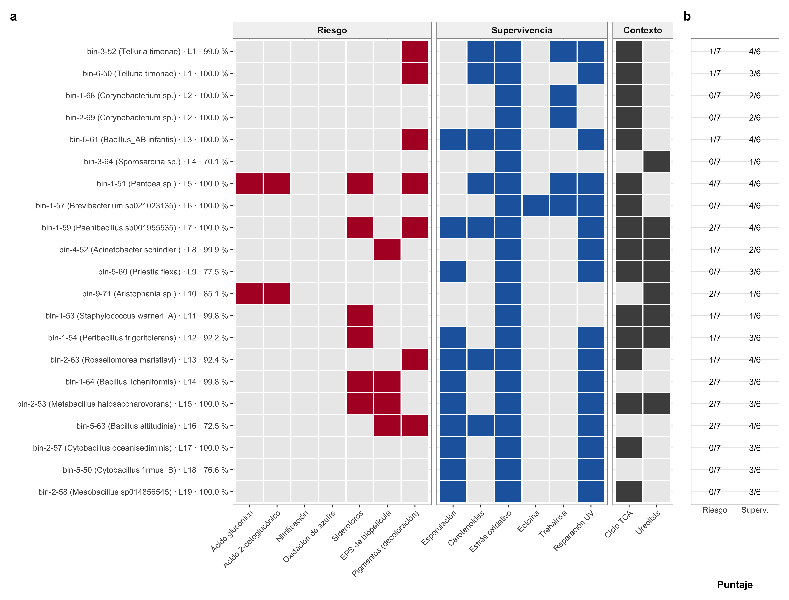

# Fase 4: como interpretar los resultados

Guia para leer las tablas y la figura de la Fase 4 (OE4). Los comandos para
correr el analisis estan en [README_fase4.md](README_fase4.md). Las cifras son de
la corrida con DRAM 1.5.0 del 29-10-2026.

## 1. La respuesta corta

La Fase 4 pregunta tres cosas sobre los 21 bins de la Estela:

| Pregunta | Respuesta |
|---|---|
| Que bins tienen genes asociados a biodeterioro? | Solo 5 de 21: *Pantoea* (L5, 2 de 6 funciones) y L8, L14, L15 y L16 (1 de 6, EPS de biopelicula). Los otros 16 tienen 0 de 6. |
| Que bins tienen genes de supervivencia? | Todos: entre 1 y 4 de 6 funciones. Destacan *Pantoea* (L5), *Brevibacterium* (L6) y un bin de *Telluria* (L1), con 4 de 6. |
| En las 3 especies con pangenoma, estos genes son propios de algunas cepas o comunes a toda la especie? | Parecen comunes a la especie: los 37 genes marcador estan en el core. Ninguno de los 44 genes especificos de la cepa es un marcador. |

**Idea principal:** estos genes describen lo que las bacterias *podrian* hacer.
No demuestran que esten deteriorando la Estela, ni que los hayan adquirido alli.

## 2. Conceptos necesarios

| Termino | Que significa aqui |
|---|---|
| Bin | Genoma reconstruido a partir de la metagenomica. Hay 21 bins en 19 linajes (L1 y L2 tienen 2 cada uno). |
| Completitud | Porcentaje estimado del genoma que esta en el bin (CheckM2). Si es baja, un gen ausente puede ser solo un gen no recuperado. |
| KO | Identificador de KEGG para una funcion genica. DRAM asigna como maximo uno por gen. |
| Marcador | KO que la tabla `metadata/marcadores_fase4.tsv` asocia a una funcion. |
| Funcion presente | El bin cumple la regla de esa funcion, por ejemplo "al menos 2 de 3 KO". Tener un KO suelto no basta. |
| Core | Genes presentes en al menos el 95 % de las referencias de la especie. |
| Accesorio | Genes presentes en menos del 95 % de las referencias (shell + cloud). |
| Especifico de la cepa | Gen del bin sin familia en las referencias y que paso los filtros de la Fase 3. |

### Las funciones evaluadas

- **Riesgo (6):** acido gluconico, acido 2-cetogluconico, EPS de biopelicula,
  curli, nitrificacion y oxidacion de azufre. Los acidos pueden disolver minerales
  y las biopeliculas favorecen la adhesion a la piedra.
- **Supervivencia (6):** esporulacion, carotenoides, estres oxidativo, ectoina,
  trehalosa y reparacion UV. Ayudan a resistir desecacion y radiacion.
- **Contexto (no puntuan):** ciclo TCA, ureolisis y CAZymes. Sirven para describir
  el metabolismo, pero no indican por si solas riesgo ni supervivencia.

## 3. Como leer la figura

- Cada fila es un bin, con su especie, su linaje y su completitud.
- Cada columna es una funcion. Una celda con color indica que la funcion esta
  presente. Una celda gris indica que **no se detecto**, no que este ausente con
  certeza.
- El panel **b** muestra el puntaje. `2/6` significa 2 funciones presentes de 6.

Conviene leer cada fila junto con su completitud. Las celdas grises de *B.
altitudinis* (72,5 %) o *Sporosarcina* (70,1 %) son menos confiables que las de
un bin al 100 %.

## 4. Que dicen los resultados

### 4.1 Funciones por bin

Datos en `figuras/tablas/tab_f4_funciones_bin.tsv`.

| Categoria | Funcion | Bins con la funcion (de 21) | Linajes |
|---|---|---:|---|
| Riesgo | Acido gluconico | 1 | L5 |
| Riesgo | Acido 2-cetogluconico | 1 | L5 |
| Riesgo | EPS de biopelicula | 4 | L8, L14, L15, L16 |
| Riesgo | Curli | 0 | |
| Riesgo | Nitrificacion | 0 | |
| Riesgo | Oxidacion de azufre | 0 | |
| Supervivencia | Estres oxidativo | 21 | todos |
| Supervivencia | Esporulacion | 11 | L3, L7, L9, L12 a L19 |
| Supervivencia | Reparacion UV | 7 | L1 (2 bins), L5, L6, L8, L13, L16 |
| Supervivencia | Trehalosa | 5 | L1 (1 bin), L2 (2 bins), L5, L6 |
| Supervivencia | Carotenoides | 4 | L1 (2 bins), L5, L7 |
| Supervivencia | Ectoina | 1 | L6 |
| Contexto | Ciclo TCA | 20 | todos menos L10 |
| Contexto | Ureolisis | 8 | L4, L7, L8, L9, L10, L11, L12, L15 |

Como leerlo:

- **Estres oxidativo** aparece en todos, asi que no distingue unos bins de otros.
- **Esporulacion** aparece en generos formadores de esporas, lo que
  sirve como control de que las reglas tienen sentido biologico.
- **Curli, nitrificacion y oxidacion de azufre** no aparecen en ningun bin. Esto
  vale para estos 21 genomas, no para toda la comunidad de la Estela.

### 4.2 Puntajes

Datos en `figuras/tablas/tab_f4_puntajes.tsv`.

El puntaje cuenta funciones presentes. Sirve para **comparar perfiles**, no para
medir deterioro. Tres avisos:

- Es **provisional** (D33): falta acordarlo con el asesor.
- Todas las funciones pesan igual, y 1/6 de EPS no equivale a 1/6 de acido.
- Todos los bins se evaluan sobre 6, aunque esten incompletos. Un bin con baja
  completitud puede tener un puntaje bajo solo por eso.

### 4.3 Prueba de Fisher: core o accesorio

Datos en `figuras/tablas/tab_f4_fisher.tsv`.

**Que pregunta hace.** En los bins de L16, L12 y L8: los genes marcador caen en la
parte accesoria mas de lo que se esperaria por azar?

**Ejemplo, L8 riesgo, definicion principal:**

| | Accesorio | Core |
|---|---:|---:|
| Gen marcador | 0 | 6 |
| Otro gen | 712 | 2 377 |

Resultado: OR = 0, IC 95 % de 0 a 2,84, p = 0,347.

**Resultados de la definicion principal:**

| Especie | Categoria | Marcadores en accesorio | Marcadores en core | Esperados en accesorio por azar | OR (IC 95 %) | p | p ajustada (BH) |
|---|---|---:|---:|---:|---|---:|---:|
| L16 *B. altitudinis* | Riesgo | 0 | 10 | 0,85 | 0 (0 a 4,84) | 1 | 1 |
| L16 *B. altitudinis* | Supervivencia | 0 | 6 | 0,51 | 0 (0 a 9,21) | 1 | 1 |
| L12 *P. frigoritolerans* | Riesgo | 0 | 0 | 0 | sin dato | sin dato | sin dato |
| L12 *P. frigoritolerans* | Supervivencia | 0 | 10 | 1,75 | 0 (0 a 2,11) | 0,227 | 0,868 |
| L8 *A. schindleri* | Riesgo | 0 | 6 | 1,38 | 0 (0 a 2,84) | 0,347 | 0,868 |
| L8 *A. schindleri* | Supervivencia | 0 | 5 | 1,15 | 0 (0 a 3,65) | 0,595 | 0,992 |

Las otras dos definiciones de accesorio (`solo_cloud` y `core_90`) tampoco dan
ningun resultado significativo.

**Como interpretarlo:**

- **Lo que se observa:** los 37 genes estan en el core. El mas bajo aparece en
  el 97,6 % de las referencias (`tab_f4_genes_marcador.tsv`).
- **Lo que no se puede concluir:** "no significativo" no prueba que no haya
  enriquecimiento. Hay muy pocos marcadores: en cada prueba se esperaba cerca de 1
  en el accesorio, asi que obtener 0 no es raro. Los IC llegan hasta OR de 2 a 9.
- **Una senal descriptiva:** sumando las cinco pruebas se esperaban unos 5,6
  marcadores en el accesorio y hubo 0. Esto no es una prueba formal.
- **Dos sesgos a favor del core:**
  - KOfam reconoce mejor los genes conservados que los genes variables.
  - Solo cuentan los genes de funciones presentes, es decir, de sistemas casi
    completos.

**Frase segura:** "las funciones detectadas en estos tres bins forman parte del
core de su especie". No implica adaptacion a la Estela (D34).

### 4.4 Genes especificos de la cepa

Datos en `figuras/tablas/tab_f4_especificos_dram.tsv`.

Es el analisis mas cercano a "lo propio de la Estela". L16 y L12 tienen 0 genes
especificos. L8 tiene 44 (21 sin bandera y 23 con bandera de advertencia).

- **Ninguno de los 44 es un marcador** de riesgo o supervivencia.
- Solo 7 tienen KO, 2 tienen familia de peptidasa y 1 tiene familia CAZy. Muchos
  son proteinas hipoteticas.
- El mejor hit es casi siempre otro genoma de *Acinetobacter* (41 de 44), asi que no parecen genes
  exclusivos de la Estela, sino genes ausentes en las referencias usadas.
- Hay transposasas, una integrasa y proteinas de fago, tipicas de elementos moviles.
- **Candidato para mirar:** `contig_62` tiene 5 genes sin bandera relacionados con
  polisacaridos (ligasa de antigeno O, glicosiltransferasa GT2, UDP-glucosa
  6-deshidrogenasa). Podria influir en la superficie celular, pero la tabla de
  marcadores no lo evalua y por ahora es solo una hipotesis.

Siempre se habla de **candidatos**: un gen ausente en las referencias no prueba
que se haya adquirido en la Estela.

### 4.5 CAZymes

Datos en `figuras/tablas/tab_f4_cazy_bin.tsv`.

Son enzimas que actuan sobre carbohidratos. Hay 1 895 genes con anotacion y 2 073
conteos gen-familia (un gen puede contar en mas de una familia). Es solo contexto:

- Mas genes: *Paenibacillus* (L7, 289) y *Metabacillus* (L15, 247).
- Menos genes: *Sporosarcina* (L4, 25), que ademas tiene baja completitud.
- Familias mas frecuentes: GT2, GT4 y GH13. GT2 y GT4 estan en los 21 bins.

Conviene comparar estos conteos con cautela, porque dependen de la longitud y de la
completitud del genoma.

## 5. Casos que requieren cuidado

Son resultados donde la regla da "ausente", pero la evidencia es menos clara.

| Bin | Funcion | Que se encontro | Lectura |
|---|---|---|---|
| L10 *Aristophania* (85,1 %) | Acido gluconico y 2-cetogluconico | Sin K00117, pero con K19813 (otra glucosa deshidrogenasa), 4 de 5 genes *pqq* y gluconato 2-deshidrogenasa | **Posible falso negativo.** Es el caso mas importante: su puntaje de riesgo de 0/6 puede estar subestimado. |
| L8 *Acinetobacter* (99,9 %) | Acido gluconico | K00117 sin genes *pqq* | Tiene la enzima pero no la via del cofactor que exige la regla. No se puede afirmar que produzca el acido. |
| L4 *Sporosarcina* (70,1 %) | Esporulacion | Solo *spo0A* | Probablemente por baja completitud. |
| L19 *Mesobacillus* (100 %) y L9 *Priestia* (77,5 %) | EPS | 6 de 13 KO, y la regla pide 9 | Sistema parcial. En L19 no se explica por completitud. |
| L1 *Telluria* | Trehalosa | Presente en `bin-3-52`, no en `bin-6-50` (falta K01087) | El mismo linaje da resultados distintos. Puede ser variacion real o un gen no detectado. |

## 6. Que se puede afirmar

| Se puede decir | No se puede decir |
|---|---|
| El bin tiene genes compatibles con producir acido gluconico | La bacteria produce acido en la Estela |
| No se detecto la funcion en este bin | La funcion no existe en ese linaje |
| Los marcadores estan en el core de la especie | Los marcadores no tienen relacion con el nicho |
| Estos genes son candidatos especificos de la cepa | La cepa adquirio estos genes en la Estela |
| L5 tiene el mayor puntaje de riesgo entre los bins | L5 es el organismo que mas deteriora la Estela |

Limites generales:

1. **Potencial, no actividad.** No se midio expresion, produccion de acido ni deterioro.
2. **Fraccion cultivable.** Los bins vienen del cultivo del hisopo B y el cultivo no
   reproduce las condiciones del monumento (D20).
3. **Genomas incompletos.** Una ausencia en un bin incompleto no prueba nada.
4. **Anotacion limitada.** Sin UniRef ni Pfam, y con un KO por gen. Los KO tambien
   cambian entre versiones de KEGG, como ocurrio con el ciclo TCA (D41).
5. **Un bin por especie.** Con 1 bin frente a referencias globales, "accesorio"
   indica variacion dentro de la especie, no adaptacion a la Estela (D34).

## 7. Que falta antes de llevarlo a la tesis

- [ ] Decidir que hacer con el caso de L10 (seccion 5). Cambiar la regla ahora
      seria un cambio hecho despues de ver los datos, y habria que declararlo.
- [ ] Revisar si KEGG dividio o renombro KO en las demas funciones. Por ahora solo
      se reviso el ciclo TCA (D41).
- [ ] Acordar el puntaje con el asesor (D33).
- [ ] Verificar con bibliografia las lecturas biologicas de este documento antes de
      citarlas, en especial la de L10.

## 8. Donde esta cada cosa

| Archivo | Para que sirve |
|---|---|
| `figuras/figs/fig_f4_matriz_funciones.png` | Vista general: empezar por aqui |
| `figuras/tablas/tab_f4_funciones_bin.tsv` | Funcion presente o no por bin, con los KO hallados |
| `figuras/tablas/tab_f4_puntajes.tsv` | Puntajes y completitud |
| `figuras/tablas/tab_f4_fisher.tsv` | Pruebas de Fisher, con las tres definiciones |
| `figuras/tablas/tab_f4_genes_marcador.tsv` | Los 37 genes marcador y su particion |
| `figuras/tablas/tab_f4_especificos_dram.tsv` | Los 44 genes especificos con su anotacion |
| `figuras/tablas/tab_f4_cazy_bin.tsv` | Genes por familia CAZy y bin |
| `metadata/marcadores_fase4.tsv` | Reglas de cada funcion |
| `results/fase4/dram/annotations.tsv` | Anotacion completa: 77 778 genes, 42 270 con KO |
